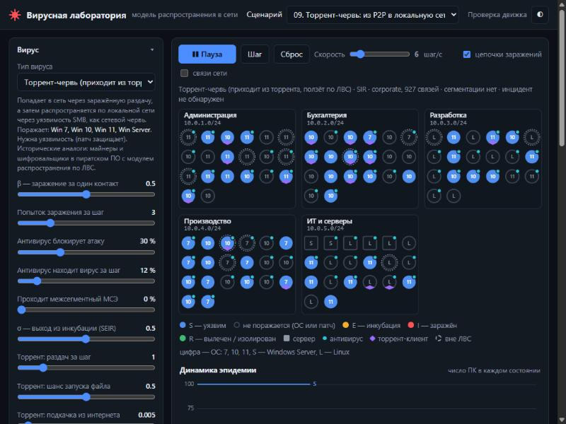

# Вирусная лаборатория — модель распространения компьютерных вирусов в сети

Учебная лаборатория для изучения того, **как компьютерные вирусы распространяются
по сети** и **какие меры защиты их останавливают**. Состоит из двух частей:

* **Интерактивный веб‑симулятор** (`web/`) — наглядная схема сети, по которой на ваших
  глазах расползается заражение; можно менять параметры на лету, щёлкать по отдельным
  ПК, заражать их, ставить патчи и изолировать.
* **Python‑пакет `virus_lab`** — та же модель в виде библиотеки и утилиты командной
  строки: пакетные прогоны (метод Монте‑Карло), перебор параметров, сравнение с
  аналитической моделью, экспорт в CSV/PNG. Подходит для расчётов в курсовой/ВКР.

> ⚠️ **Это математическая модель, а не вредоносная программа.** В проекте нет
> вредоносного кода и он не выполняет никаких реальных сетевых действий. «Вирусы»
> здесь — это наборы числовых параметров (вероятность заражения, скорость, обход
> защиты), калиброванных под поведение реальных семейств. Так же устроены учебные
> модели NetLogo «Virus on a Network», библиотеки NDlib и EoN, модели SIR/SEIR на
> кафедрах информационной безопасности.



*Торрент‑червь в корпоративной сети: фиолетовые ромбы — торрент‑пользователи,
пунктирные кольца — ПК вне локальной сети, бирюзовые стрелки — заражение через
торрент, красные — по ЛВС.*

## Что можно изучать

* Как **топология сети** (отделы, серверы‑мосты, плоская сеть, звезда, «малый мир»,
  безмасштабная сеть) влияет на скорость и охват эпидемии.
* Как работают **меры защиты**: установка патчей, антивирус, сегментация сети
  (межсетевой экран между отделами), осведомлённость персонала, блокировка торрентов.
* Чем отличаются **разные векторы заражения**: сетевой червь по ЛВС, почтовый червь,
  вирус на флешках, скрытая целевая атака (APT), червь для Linux, **торрент‑вирусы**.
* Как **реагирование на инцидент** (обнаружение → задержка → патчи, карантин,
  сегментация) меняет исход.
* Что такое **R₀**, **порог коллективного (сетевого) иммунитета** и **итоговый размер
  эпидемии**, и насколько сетевая модель расходится с «школьной» однородной.

## Два канала распространения

Вирус в модели может распространяться по двум независимым каналам:

| Канал | Как работает | Кого достаёт |
|-------|--------------|--------------|
| **ЛВС** (локальная сеть) | заражённый ПК атакует соседей по графу связей | только ПК, подключённые к сети |
| **Торрент (P2P)** | заражённый файл раздаётся другим торрент‑пользователям + подкачивается из интернета | **любые** торрент‑ПК, в том числе **не подключённые к ЛВС** (домашние, автономные) |

Поэтому в лаборатории есть **связанные и несвязанные компьютеры**: ПК «вне ЛВС» не
имеют сетевых связей — обычный сетевой червь до них не доберётся, а торрент‑троян — да.

## Быстрый старт

### Веб‑симулятор

Не требует установки — только статические файлы. Из каталога проекта:

```bash
python -m http.server 8000 --directory web
```

Откройте <http://localhost:8000/>. Нажмите **Пуск** — заражение начнёт расползаться.
Страница **Проверка движка** (`web/test.html`) сверяет JavaScript‑движок с эталоном
Python: оба должны давать побитово одинаковый результат при одном seed.

### Командная строка (нужен Python ≥ 3.9)

```bash
python -m virus_lab run                 # один прогон сценария по умолчанию
python -m virus_lab run -s scenarios/08_torrent_trojan.json --log 20
python -m virus_lab viruses             # описание всех вирусов и моделей
python -m virus_lab inventory           # список всех 100 ПК виртуальной сети
```

Графики (нужен `matplotlib`, см. `requirements.txt`):

```bash
pip install -r requirements.txt
python -m virus_lab run -s scenarios/01_worm_baseline.json --plot out.png
```

## Команды `virus_lab`

| Команда | Назначение |
|---------|-----------|
| `run` | один прогон: ASCII‑график, итоги, журнал событий, экспорт CSV/JSON/PNG |
| `sweep` | серия прогонов с перебором параметра (Монте‑Карло): влияние защиты на исход |
| `theory` | R₀, порог коллективного иммунитета, сравнение с аналитической моделью |
| `inventory` | таблица всех ПК сети (ОС, патчи, антивирус, торрент, связи) |
| `viruses` | справочник вирусов, их параметров и эпидемических моделей |
| `build-web` | пересобрать `web/data.js` и эталоны проверки из Python‑кода |

Любой параметр можно переопределить флагом `--set`:

```bash
# как доля ПК с патчем влияет на охват эпидемии (по 50 прогонов на значение)
python -m virus_lab sweep --param network.patch_coverage \
       --values 0,0.2,0.4,0.6,0.8,1.0 --runs 50 --plot patch.png

# сравнить топологии сети
python -m virus_lab sweep --param network.topology \
       --values corporate,flat,star,small_world,scale_free --runs 40

# крупная сеть на 300 ПК с реагированием на инцидент
python -m virus_lab run --set network.hosts=300 --set network.subnets=10 \
       -s scenarios/06_incident_response.json
```

## Вирусы (пресеты)

| ID | Название | Вектор | Исторические аналоги |
|----|----------|--------|----------------------|
| `worm_smb` | Сетевой червь (эксплойт SMB) | уязвимость службы Windows, без участия пользователя | Conficker, WannaCry, NotPetya |
| `email_worm` | Почтовый червь | вредоносное вложение, нужна реакция пользователя | ILOVEYOU, Mydoom, Emotet |
| `usb_virus` | Вирус на флешках | съёмные носители и общие папки, в обход МСЭ | Agent.btz, Stuxnet (USB) |
| `apt_stealth` | Скрытая целевая атака (APT) | медленное перемещение по учётным данным | целевые APT‑кампании |
| `linux_worm` | Червь для Linux (SSH) | подбор слабых паролей SSH | червь Морриса, Mirai |
| `torrent_trojan` | Троян в торрент‑раздаче | «взломанное» ПО, распространяется по P2P | P2P‑черви Kazaa, майнеры в пиратских играх |
| `torrent_worm` | Торрент‑червь | приходит из торрента, затем ползёт по ЛВС | пиратское ПО с модулем распространения |

## Эпидемические модели

* **SI** — заражённый ПК остаётся заражённым навсегда (верхняя оценка).
* **SIS** — вылеченный ПК снова уязвим (вирус может стать эндемичным).
* **SIR** — вылеченный ПК приобретает иммунитет (классическая модель вспышки).
* **SEIR** — SIR со скрытым (инкубационным) периодом E.

## Структура проекта

```
virus-spread-lab/
├── virus_lab/            Python-пакет (модель, CLI)
│   ├── rng.py            детерминированный ГСЧ (общий с JS)
│   ├── network.py        генерация сети и топологий
│   ├── viruses.py        пресеты вирусов
│   ├── simulation.py     агентная модель (ядро)
│   ├── theory.py         аналитическая (среднеполевая) модель, R0
│   ├── experiments.py    сценарии, Монте-Карло, перебор параметров
│   ├── plots.py          графики (ASCII и matplotlib)
│   ├── webexport.py      генерация данных и эталонов для веба
│   └── cli.py            командная строка
├── web/                  веб-симулятор (статические файлы)
│   ├── index.html        интерфейс
│   ├── engine.js         движок (порт модели на JS)
│   ├── app.js            визуализация и управление
│   ├── data.js           данные (сгенерированы из Python)
│   ├── parity_fixture.js эталоны проверки (сгенерированы)
│   └── test.html         проверка совпадения JS и Python
├── scenarios/            готовые сценарии (JSON)
├── tests/                автотесты модели
├── docs/                 методичка и материалы
│   └── МЕТОДИЧКА.md       лабораторные работы для студентов
├── requirements.txt
└── README.md
```

## Соответствие Python и JavaScript

Веб‑движок (`engine.js`) — построчный порт Python‑модели с тем же детерминированным
генератором случайных чисел (`mulberry32`) и тем же порядком вызовов. При одинаковом
seed обе реализации дают **идентичный** результат. Это проверяется автоматически:
`web/test.html` сверяет 14 сценариев (структуру сети и всю траекторию эпидемии).
После изменения модели в Python пересоберите данные для веба:

```bash
python -m virus_lab build-web
```

## Тесты

```bash
python -m unittest discover -s tests -v
```

## Лицензия

MIT — см. [LICENSE](LICENSE). Используйте свободно в учебных и исследовательских целях.
